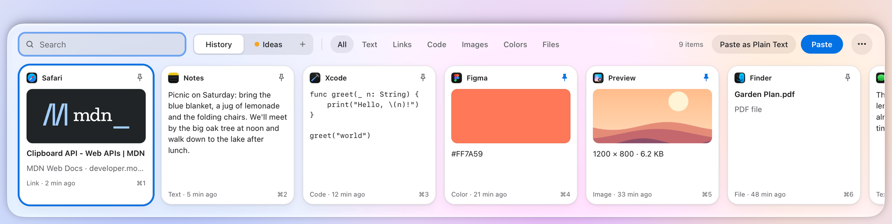

# Satchel

**A fast, private clipboard manager for macOS.** Free and open source (MIT).

<p align="center">
  <a href="https://github.com/hoomanaskari/Satchel/releases/latest">
    
  </a>
</p>

Satchel keeps a searchable history of what you copy. Press a shortcut, and a shelf slides up from the bottom of the screen: pick a clip and it pastes into the app you were using. Your history stays on your Mac.

<picture>
  <source media="(prefers-color-scheme: dark)" srcset="docs/images/shelf-dark.png" />
  <source media="(prefers-color-scheme: light)" srcset="docs/images/shelf.png" />
  
</picture>

> **Status: early.** Satchel 0.1 is the first public version, for **macOS 11 (Big Sur) or later on Apple silicon** (M1 or newer).
> The code is laid out for Windows and Linux too, but those versions aren't built or tested yet.

## Download

1. Get the newest `Satchel_<version>_*.dmg` from [Releases](https://github.com/hoomanaskari/Satchel/releases/latest).
2. Open it and drag Satchel to Applications.
3. Open Satchel. It lives in the menu bar (a small satchel icon), not in the Dock.

## First run

1. **Open the shelf** with `⌘⇧V`. You can change the shortcut in Settings.
2. **Allow pasting.** To paste into other apps, Satchel needs the Accessibility permission. The first time you paste, Satchel copies the clip instead and shows **Open Accessibility Settings…**. Turn Satchel on in System Settings > Privacy & Security > Accessibility, then paste again.
3. **Check what's excluded.** Settings > Never capture from lists the apps Satchel ignores. Common password managers are on it already.

## What it does

- **Keeps what you copy:** text (with its formatting), links, code, colors, images (screenshots, Preview, Photos, browsers' Copy Image) and files from Finder.
- **A shelf over the Dock:** cards show the source app, the kind of clip, when you copied it and a preview. On macOS 26 the shelf uses Liquid Glass.
- **Search** as you type, and filter by kind: Text, Links, Code, Images, Colors, Files.
- **Paste from the keyboard:** arrow keys to choose, `Return` to paste, `⇧Return` to paste as plain text, `⌘1` to `⌘9` to paste one of the first nine clips, `⌘C` to copy without pasting, `Space` for a larger preview, `⌘⌫` to delete.
- **Paste several clips at once:** `⇧`- or `⌘`-click to select, then paste them in order.
- **Pinboards:** pin clips (`⌘P`) to named, colored pinboards. Pinned clips are never removed.
- **Titles:** rename a clip so it's easy to find again.
- **Link previews:** the page's title and image on link cards (see [Privacy](#your-privacy)).
- **Updates itself:** when a new version is out, the menu bar icon gets a dot and one click installs it (see [Privacy](#your-privacy)).
- **Pause capturing** from the menu bar icon or Settings. The menu bar icon shows a short animation each time a clip is saved (none with Reduce Motion on).
- **History limits:** keep up to 2,000 clips and 90 days by default. Both are in Settings.

## Your privacy

Clipboard history holds passwords and other secrets, so Satchel is built to keep less, not more.

- **Your history stays on your Mac.** It's a local database in Satchel's own folder, readable only by your user account. It isn't encrypted beyond what macOS gives your disk (for example FileVault). There are no accounts, no sync and no analytics.
- **Some copies are never kept:** anything copied in an excluded app, and anything an app marks as concealed or temporary (password managers do this). You can add or remove excluded apps in Settings > Never capture from.
- **Deleting means deleting.** Deleted clips are overwritten in the database, not just hidden.
- **Two things use the network: link previews and update checks.** Both are on by default and both can be turned off. With both off, Satchel makes no network requests at all.
- **Link previews.** When you copy a web link, Satchel fetches that page once, in the background, from the link's own site, to show its title and image. That site sees the link and your IP address. Links already in your history are fetched slowly, one every 15 seconds.
- **Some links are never fetched:** links from excluded apps; sign-in, password-reset, one-time and other links that carry tokens or random-looking IDs; links with a user name or password; IP addresses, local names and unusual ports; and anything that leads to a private network address. Satchel fetches over HTTPS only, sends no cookies, runs no page scripts and removes tracking parameters.
- **To turn link previews off:** Settings > Shelf > uncheck **Show link previews**, then Save. Satchel then fetches no pages and deletes the saved previews.
- **Update checks.** When it starts and every 6 hours after, Satchel asks GitHub for `latest.json` from its newest release ([github.com/hoomanaskari/Satchel/releases](https://github.com/hoomanaskari/Satchel/releases)). The request carries nothing about you, your Mac or your clips: no ID, no version number, no settings, just a plain request that any program could make (GitHub sees your IP address and that it's Satchel's updater asking). When a new version is out, the menu bar icon gets a small dot and the menu offers **Update to Satchel …**; nothing pops up. Satchel downloads the update only when you choose it, checks that it was signed with Satchel's own signing key, installs it and reopens.
- **To turn update checks off:** Settings > Updates > uncheck **Check for updates automatically**, then Save. Satchel then never checks on its own; **Check Now** in Settings or **Check for Updates…** in the menu bar still checks when you ask.

The details are in [docs/ARCHITECTURE.md](docs/ARCHITECTURE.md), under "Security rules", "Link previews" and "Updates".

## Building from source

See [docs/BUILDING.md](docs/BUILDING.md). Tests run with:

```bash
cargo test --workspace
```

```bash
pnpm test
```

## Contributing

Bug reports and fixes with tests are welcome. See [CONTRIBUTING.md](CONTRIBUTING.md). For security problems, see [SECURITY.md](SECURITY.md).

## Licence

[MIT](LICENSE). Satchel uses open source libraries under their own licences (mostly MIT and Apache-2.0).

Satchel includes open source software from other projects; their licences and copyright notices are in [THIRD-PARTY-NOTICES.txt](THIRD-PARTY-NOTICES.txt) and in the app under Settings › Acknowledgements….
